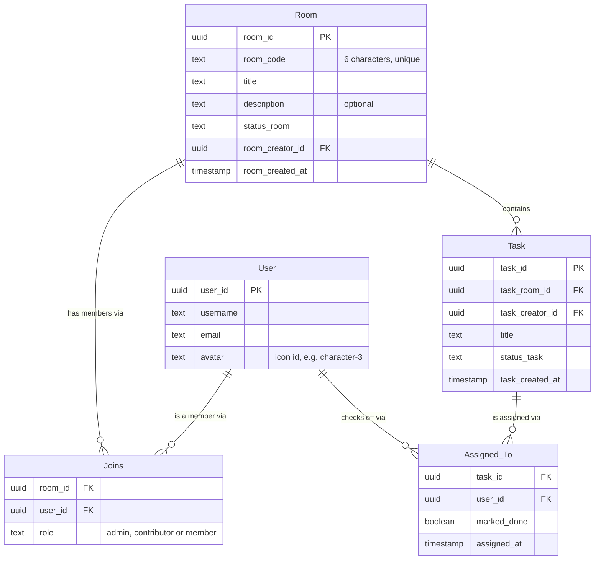

<p align="center">
  
</p>

<h1 align="center">HuddleUP</h1>

<p align="center">
  <strong>Huddle up. Finish together.</strong><br />
  A shared checklist where every task is a team effort: it's only done when <em>everyone</em> is done.
</p>

<p align="center">
  <a href="https://huddle-up-drab.vercel.app"><strong>Live site →</strong></a>
</p>

<p align="center">
  <sub>A project for <strong>CMSC 127: File Processing and Database Systems</strong> · University of the Philippines Cebu</sub>
</p>

---

## What it does

Group projects always have tasks that *everyone* is supposed to do, and nobody knows who actually did them. In HuddleUP:

1. **Create a room** and share its 6-character code with your team.
2. **Every task goes to every member.** Each person checks it off for themselves.
3. **A task is complete only when the whole team has checked it.** Then it's delivered to the room's **Completed** inbox.

### Features

| | |
|---|---|
| 📬 **Completed inbox** | Finished tasks land in an inbox as "letters". Any member can reopen one. |
| ⏳ **"The team is waiting on you"** | When you're the last one left on a task, it glows amber in the room and shows up on your dashboard. |
| 👀 **Who did what** | Each task shows every member's avatar, with a check on the people who've finished. |
| ↩️ **Mis-click protection** | Only the checkbox toggles a task, and finishing one for the team gives you a few seconds to **Undo**. |
| 🔑 **Roles** | Room owners can let members add tasks, and write an optional room description. |
| 🧑‍🎨 **Profile icons** | Pick from 16 hand-drawn avatars (8 feminine, 8 masculine). |
| ↕️ **Prioritize rooms** | Drag rooms in the sidebar to reorder them. The order is saved to your account. |
| 📱 **Works on phones** | Responsive layout with a slide-out sidebar. |

## Tech stack

- **Frontend:** [Vue 3](https://vuejs.org/) + TypeScript, built with [Vite](https://vite.dev/)
- **UI:** [PrimeVue 4](https://primevue.org/) and PrimeIcons, with custom CSS (brand colors live in `src/App.vue`)
- **Backend:** [Supabase](https://supabase.com/) (Postgres, Auth, Realtime, Row Level Security)
- **Hosting:** [Vercel](https://vercel.com/)

## Getting started

**You need:** Node.js `20.19+` or `22.12+`, and a Supabase project.

```sh
git clone https://github.com/Side-Projs/HuddleUP.git
cd HuddleUP
npm install
```

Create a file called **`.env.local`** in the project root (it's git-ignored, so it never gets committed):

```env
VITE_SUPABASE_URL=https://your-project.supabase.co
VITE_SUPABASE_PUBLISHABLE_KEY=your-publishable-anon-key
```

Find both values in Supabase under **Project Settings → API**. Only use the public *anon/publishable* key here, never the `service_role` key: anything starting with `VITE_` is bundled into the browser code.

Then start the dev server:

```sh
npm run dev
```

### Scripts

| Command | What it does |
|---|---|
| `npm run dev` | Start the dev server with hot reload |
| `npm run build` | Type-check (`vue-tsc`) and build for production into `dist/` |
| `npm run preview` | Serve the production build locally |
| `npm run lint` | Run oxlint and ESLint (with auto-fix) |
| `npm run format` | Format `src/` with Prettier |

## Database

HuddleUP uses five tables. Here are the columns the app reads and writes:



**How "done" works:** creating a task inserts one `Assigned_To` row for every room member, and joining a room assigns all of its existing tasks to the new member. A task is complete when **every** one of its `Assigned_To` rows has `marked_done = true`. Nothing is stored for "completed"; the app works it out from those rows.

**Roles** (`Joins.role`): `admin` is the room owner, `contributor` is a member the owner allowed to add tasks, and `member` is everyone else.

> Supabase ignores updates and deletes blocked by Row Level Security without returning an error. The app asks for the changed rows back, so a blocked action shows an error instead of looking like it worked.

## Project structure

```text
src/
├── pages/          # Landing, Login, Signup, Dashboard, Room, Edit Profile
├── layouts/        # AuthLayout (login/signup), MainLayout (sidebar + top bar)
├── components/     # UserAvatar, SortableRoomList, HeroDemo (landing animation)
├── composables/    # useAuth, useRooms, useTasks: all Supabase calls live here
├── lib/avatars.ts  # The list of profile icons
├── router/         # Routes and the login guard
├── App.vue         # Global styles and design tokens (--hu-*)
└── main.ts         # App setup and the PrimeVue theme
utils/supabase.ts   # Supabase client
public/             # Logo, illustrations, avatars, dither graphics
```

## Deploying

The live site deploys from `main` on Vercel:

1. Import the repo into Vercel (it detects Vite automatically).
2. Add `VITE_SUPABASE_URL` and `VITE_SUPABASE_PUBLISHABLE_KEY` under **Settings → Environment Variables**.
3. In Supabase, go to **Authentication → URL Configuration** and add your Vercel URL as the Site URL and as a redirect URL.

`vercel.json` sends every path to `index.html`, so refreshing on a page like `/main/dashboard` works.

## Team

- Russel Niño Buno
- Kyle Casirayan
- Feahmar Bentazal
- CJ Clarence Retiza

## Credits

- Profile avatars: [Notionists](https://heyzoish.gumroad.com/l/notionists) by Zoish, generated with [DiceBear](https://www.dicebear.com/). Licensed **CC0 1.0** (see `public/avatars/LICENSE.txt`).
- Icons: [PrimeIcons](https://primevue.org/icons/).
